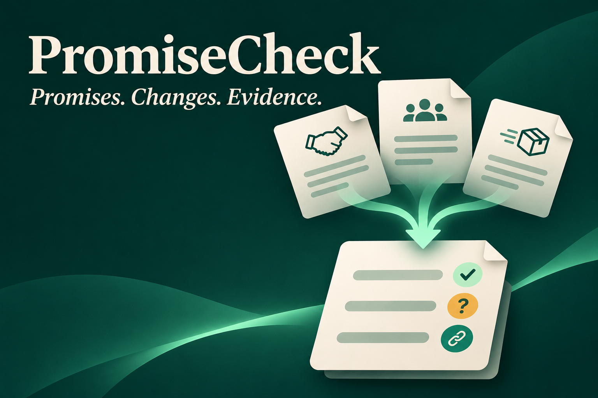

# PromiseCheck

**Know what was promised, what changed, and what the project records actually support.**

PromiseCheck is a pre-test UGREEN NAS Skill for small teams, freelancers, agencies, and clients. It compares authorized agreements, meeting records, and delivery updates to produce an evidence-backed commitment report.

Built for the **Automate Your Workflow** track of the UGREEN Hackathon 2026.



## The problem

Project commitments are scattered across agreements, meeting discussions, and status updates. Reconstructing the current scope and understanding delivery evidence takes time, especially when documents disagree.

PromiseCheck connects those records while preserving uncertainty. It distinguishes a proposed change from an authorized approval, a completion claim from independent verification, and missing evidence from proven non-delivery.

## What it produces

A commitment report covering:

- The original promise, owner, deadline, and acceptance criteria where stated.
- Proposed changes, explicit approval evidence, and approval authority.
- Reported delivery and acceptance as separate facts.
- Supporting excerpts and available source locators.
- Contradictions, missing records, and focused follow-up questions.

It does not determine legal breach, authenticate documents, or independently test delivered work.

## User experience

The user interacts with Uliya through chat. PromiseCheck provides the workflow; a separate chatbot application is not included.

Example request:

> Compare the agreement, meeting records, and delivery update in my selected project folder. Show what was promised, what changed, and what still needs confirmation. Present the report before saving it.

The user confirms the authorized sources and baseline. The Skill coordinates registered experts, presents the report, and offers to save a separate copy after approval. It does not modify source records.

## How it works

1. **Confirm scope:** Obtain an authorized folder or explicit file list and identify the baseline agreement.
2. **Discover records:** Delegate file discovery to `file-agent` using supported `ug-filesystem` capabilities.
3. **Extract commitments:** Delegate document reading, extraction, and reconciliation to `document-agent` using `ug-document`.
4. **Optional transcription:** Delegate a selected meeting recording to `knowledge-agent` using `ug-knowledge`.
5. **Compare evidence:** Preserve original terms, proposed changes, approval evidence, and delivery claims separately.
6. **Review and save:** Present the report and use the approved text-save workflow only when requested.

Real completed upstream results feed downstream tasks. Missing or unreadable inputs produce explicit coverage warnings. An unreadable baseline stops commitment classification. Pending approval, cancellation, and failure are not reported as success.

The Skill adds no external model API. Actual processing location depends on the NAS model configuration; local storage does not guarantee local-only inference.

## Repository layout

```text
promise-check/
  SKILL.md                         Required Skill entry point
  references/
    review-rules.md                Evidence and approval rules
    report-format.md               Output structure
    validation-cases.md            Planned runtime checks
    disclosures.md                 Provenance and dependencies
samples/
  website-project/                 Three fictional input records
  EXPECTED-RESULTS.md               Human answer key; keep outside input scope
  TRY-IT.md                        Assigned-NAS testing instructions
tools/
  prepare-deliverables.py           Local PDF, packaging, and release checks
output/
  PromiseCheck-Pretest-v1.0.zip     Round 1 Skill package
  pdf/PromiseCheck-Proposal.pdf     Round 1 proposal
  PromiseCheck-Proposal-Editable.md
  PromiseCheck-Thumbnail.png
  DEVPOST-COPY.md                   Suggested project-form text
  START-HERE.md                     Entrant checklist and eligibility note
  validation/                      Static-check results and PDF previews
```

The local `uliya-skill-kit-0.7.3-en/` directory is the official development resource supplied separately. It is not part of the submitted Skill ZIP.

## Deliverables

- [Pre-test Skill ZIP](output/PromiseCheck-Pretest-v1.0.zip)
- [Proposal PDF](output/pdf/PromiseCheck-Proposal.pdf)
- [Editable proposal](output/PromiseCheck-Proposal-Editable.md)
- [Project thumbnail](output/PromiseCheck-Thumbnail.png)
- [Submission checklist](output/START-HERE.md)
- [Suggested Devpost text](output/DEVPOST-COPY.md)

The proposal contains 352 substantive response words, or 395 including its question headings, excluding the separate disclosure section. The checked ZIP contains five Markdown files only. This README, development scripts, sample data, answer key, and artwork are intentionally outside the Skill package.

## Validation status

As of November 9, 2026:

- Official toolkit checker: **static-pass, zero errors and warnings**.
- ZIP structure, file limits, integrity, and packaged bytes checked.
- Proposal text extracted and checked; PDF rendered and visually reviewed.
- Fictional test records, expected outcomes, and runtime validation instructions prepared.

**Not yet validated:** NAS installation, Uliya execution, supported input behavior, model accuracy, transcription, source fidelity, permissions, and live saving. Static checks do not prove upload acceptance or device execution. Expected results are a design reference, not observed runtime output.

See [official checker output](output/validation/official-check.json) and [release checks](output/validation/release-checks.json).

## Testing on an assigned NAS

Follow [TRY-IT.md](samples/TRY-IT.md) when authorized device access is available. Local paths are not NAS paths; select actual authorized NAS locations at runtime. Follow the current official instructions for installing and invoking the Skill on the assigned device.

The fictional scenario contains:

- A homepage reported complete without recorded client acceptance.
- A contact form with an authorized deadline change and incomplete email testing.
- A guide with an unapproved deadline proposal and no delivery evidence in the selected update.
- A proposed analytics dashboard that was never approved as scope.

Keep [the answer key](samples/EXPECTED-RESULTS.md) outside the reviewed folder. Also test an unreadable baseline, uncertain approval authority, conflicting records, and denied or cancelled saves. Record actual results rather than assuming the expected answers were achieved.

## Local development

Run the bundled official checker from the workspace root:

```powershell
node uliya-skill-kit-0.7.3-en/uliya-skill-kit/scripts/check-skill.mjs promise-check
```

The local deliverable utility requires Python with ReportLab and pypdf, plus Node.js for the official checker:

```powershell
python tools/prepare-deliverables.py
```

This utility regenerates the proposal and the named release ZIP. Preserve an existing release before rebuilding if you need a historical copy. It is a development utility, not part of the NAS Skill. Render and inspect any revised proposal before submission.

## AI assistance and third-party resources

Codex assisted with planning, original Skill authoring, synthetic examples, validation commands, and packaging. OpenAI image generation created the project thumbnail; it is promotional artwork, not a runtime screenshot. The UGREEN toolkit provided capability definitions, authoring guidance, and static checks.

The Skill ZIP bundles no third-party runtime library, executable, model weights, or external API integration. Local development used Python, ReportLab, pypdf, Node.js, and Poppler. See the [Skill disclosures](promise-check/references/disclosures.md) for the development resources documented in the package. pypdf, used outside the package to inspect the proposal PDF, is distributed under BSD-3-Clause: https://pypdf.readthedocs.io/en/stable/meta/license.html .

No open-source license is granted for the PromiseCheck project by this README. Third-party tools remain governed by their own terms and licenses. Do not infer a redistribution license for the UGREEN toolkit.

## Submission and eligibility

No entry has been submitted by Codex. Before entering, read the current [official rules](https://ugreenhackathon.devpost.com/rules) and [starter kit](https://ai.ugreen.com/pages/hackathon-starter-kit).

**The rules checked on November 9, 2026 explicitly exclude residents of India.** If this applies to you, resolve eligibility with the organizer before attempting entry. Do not misstate residence or assume that an eligible team representative makes every member eligible. An organizer clarification request is provided in [START-HERE.md](output/START-HERE.md).

If eligible, complete the actual Devpost form and upload the proposal PDF and Skill ZIP separately. Round 1 does not require a repository or demo video under the checked rules. SkillHub publishing is separate from competition submission.

Round 1 deadline: **November 15, 2026 at 11:45 p.m. PST**, equivalent to **November 16 at 1:15 p.m. IST**. Recheck current event instructions before acting.
